<p align="center">
  
</p>

<h1 align="center">Course Report Writer · DOCX / LaTeX / Typst</h1>

<p align="center">
  A Codex Skill for Chinese coursework reports, lab reports, course papers, and DOCX / LaTeX / Typst delivery.
  <br>
  It combines evidence, writing, selected-format builds, and delivery checks in one workflow.
</p>

<p align="center">
  Language:
  <a href="README.md">简体中文</a> |
  <strong>English</strong>
</p>

<p align="center">
  <a href="#quick-start"></a>
  <a href="#quality-gates"></a>
  <a href="#subagent-settings"></a>
  <a href="#diagram-qa"></a>
  <a href="LICENSE"></a>
</p>

---

## Optimization status

DOCX, LaTeX and Typst authoring use matching built-in templates. Ask for the format unless explicitly specified; native formats deliver source plus PDF. The main agent integrates the report; substantial reports use bounded specialists and an independent reviewer when available, while small edits stay local. Disclose subagent models, reasoning efforts and concurrency at first use; users may adjust or disable them. See [collaboration settings](references/multi-agent-workflow.md). Keep one full review and at most two focused repair rounds. Superpowers is optional. See [commands and limits](references/output-formats.md), [native templates](references/native-templates.md), and [platform status](docs/platform-support.md).

All **59 automated tests pass**, including 12 placeholder-fidelity regressions and a compiled-PDF CJK line-spacing check. Placeholder replacement preserves unaffected formatting/media and rejects complex boundaries. The Typst body now uses an approximately 17 pt baseline gap with more space around headings and references. The 12 read-only scenarios remain historical evidence. Word/WPS final appearance, Windows execution and quality/speed A/B comparisons remain unverified. See the [current verification record](docs/verification-2026-10-27.md).

## Latest three-format report example

The same Chinese multi-agent research report was built separately as DOCX, LaTeX and Typst: five chapters, about 5,138 Chinese characters and 14 references.

| Format | Report | Editable source | Status |
|---|---|---|---|
| DOCX | [DOCX](examples/multiagent-report/report.docx) · [PDF preview](examples/multiagent-report/report-docx-preview.pdf) | DOCX itself | Body/layout checked; **TOC still needs updating, not submission-ready** |
| LaTeX | [11-page PDF](examples/multiagent-report/report-latex.pdf) | [Source project](examples/multiagent-report/latex) | Native build and independent page review passed |
| Typst | [Revised 10-page PDF](examples/multiagent-report/report-typst.pdf) | [Source project](examples/multiagent-report/typst) | Dense layout corrected; all pages and spacing regression checked |

| DOCX / LibreOffice | LaTeX | Revised Typst |
|---|---|---|
| 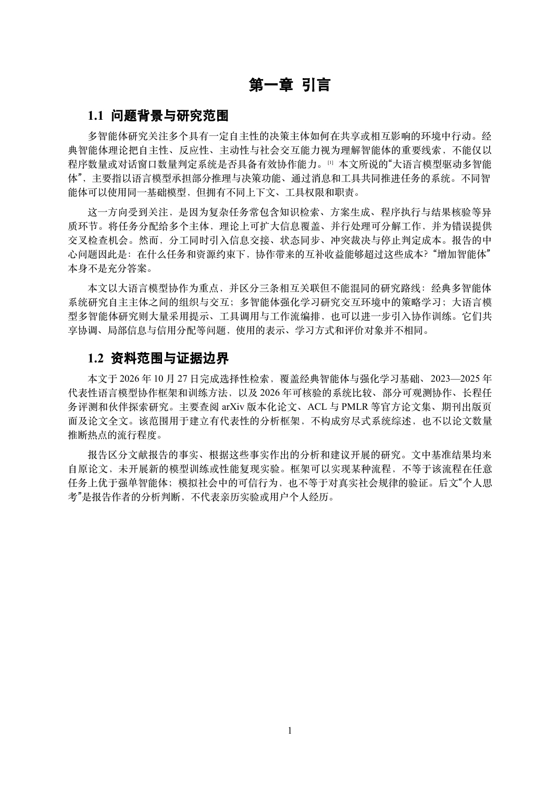 | 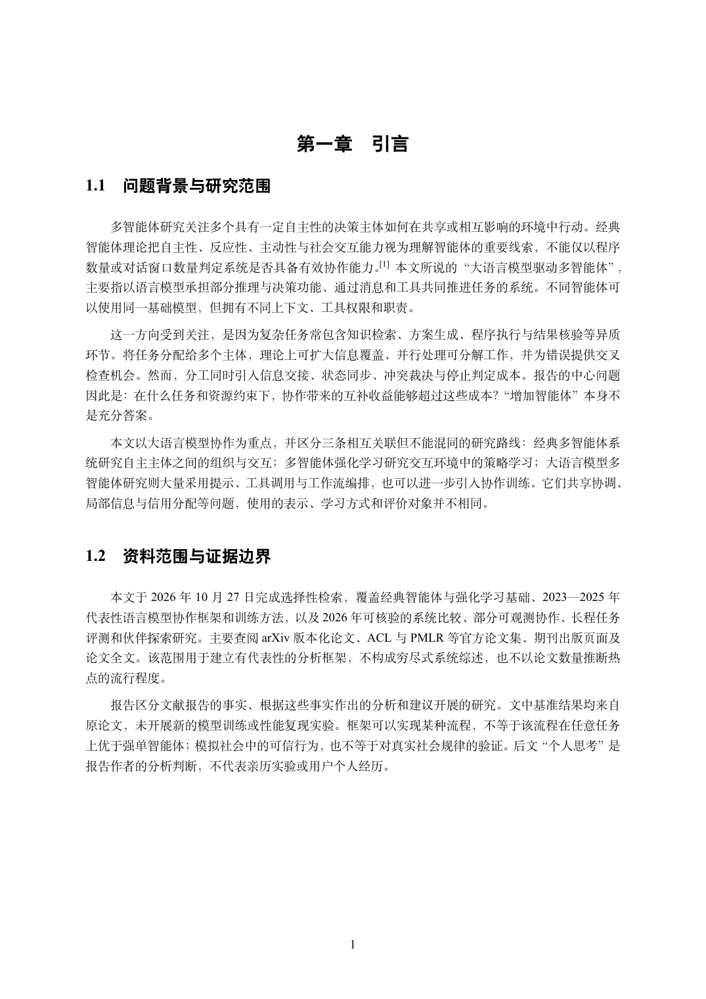 | 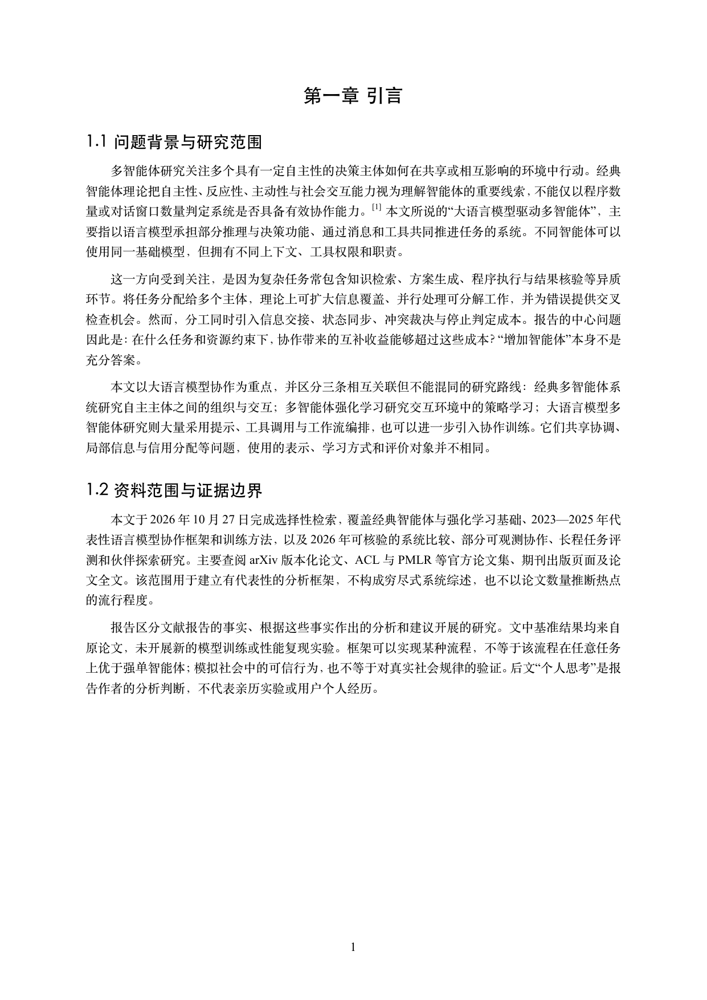 |

Typst's measured body baseline gap increased from 12.02 to 17.00 pt without changing the report content. [Editable figure PPTX](examples/multiagent-report/figures/collaboration.pptx), [vector PDF](examples/multiagent-report/figures/collaboration.pdf) and [scope/build notes](examples/multiagent-report/README.md) are included. This is a literature report with a conceptual illustration, not a new model experiment.

<a id="subagent-settings"></a>

## Default subagent settings

| Task | Default model | Reasoning effort |
|---|---|---|
| Evidence verification and bounded tasks such as figures | `gpt-6.1-sol` | `medium` |
| Independent final review | `gpt-6.1-sol` | `high` |

At first report use, check host capabilities, disclose these settings, and offer adjustment or disabling. Record and reuse explicit project preferences without changing the main agent's model. Disclose unavailable settings instead of silently substituting; requested parameters alone are not runtime confirmation.

Defaults allow at most **2 active subagents** and **3 worker tasks per report**, also limited by host capacity. The main agent integrates the argument, terminology, numbers and citations; one independent reviewer owns the full review. All roles share at most two repair rounds. These are adjustable starting settings, not a measured optimum. The [collaboration workflow](references/multi-agent-workflow.md) is authoritative.

## Companion skills and informed intake

Before execution, consider installed, available skills that materially improve the task. Examples: `nature-academic-search` for literature/citations, `nature-writing` for drafting, `nature-polishing` for existing prose and `nature-image2ppt` for requested editable reconstruction. Load only selected task-relevant guidance; these are not mandatory dependencies or a workflow chain. Preserve the assignment's style and evidence boundaries.

When asking for format, explain both benefits and limits: DOCX suits visual Word/WPS editing and school templates but pagination/fields may vary across applications; LaTeX excels at equations/references and stable PDF layout but requires syntax/compiler knowledge; Typst offers concise source and convenient previews but a smaller template ecosystem and no direct Word/LaTeX compatibility.

Ask whether AI illustrations are wanted. Only after Yes, ask their insertion count and whether to rebuild them as editable PPT objects, export PDF and insert into the report. No skips the follow-ups; reuse explicit answers. Reconstruction adds work and may retain raster textures/photos. Deliver PPTX and PDF and verify vector preservation in the report. The DOCX builder accepts single-page PDF and self-contained static SVG paths in Markdown figures, using the optional `PyMuPDF` dependency. PDF is converted to SVG; DOCX retains SVG plus a PNG compatibility preview. Inspect the actual report export to determine which representation the application uses. An image-only PPT/PDF is not vectorization or object-level editing in Word. See [intake](references/intake-and-run-record.md), [PPT reconstruction and insertion](references/ppt-figure-reconstruction.md) and the [Transformer verification record](docs/verification-2026-10-23.md#transformer-vector-figure-end-to-end-run).

## What It Does

`docx-course-report-writer` is a local Codex Skill for producing and repairing Chinese academic DOCX/LaTeX/Typst report outputs. It starts with task intake and evidence planning, asks for the required output format (DOCX, LaTeX→PDF, or Typst→PDF), generates or repairs the target deliverables, then verifies fields, table of contents, diagrams, layout, and factual consistency before delivery.

Use it for:

- Chinese course reports, lab reports, course papers, reading reports, and literature reviews.
- Reports that depend on real code output, logs, screenshots, figures, citations, or data tables.
- Word reports that must follow a user-provided template or the integrated default template.
- LaTeX/TikZ diagrams, flowcharts, architecture diagrams, screenshots, and data plots inside DOCX.
- Repairing existing DOCX files with stale content, broken TOCs, outdated fields, poor diagrams, or PDF export issues.

## Contents

- [Why Use It](#why)
- [Demo](#demo)
- [Features](#features)
- [Quick Start](#quick-start)
- [Subagent Settings](#subagent-settings)
- [Workflow](#workflow)
- [Superpowers Workflow](#superpowers-workflow)
- [Bounded Artifact Review](#actor-critic)
- [WSL And Screenshot Highlights](#wsl-screenshot)
- [Diagram QA](#diagram-qa)
- [Default Template](#default-template)
- [Quality Gates](#quality-gates)
- [Project Structure](#project-structure)
- [Examples](#examples)
- [FAQ](#faq)

<a id="why"></a>

## Why Use It

Many generated reports fail in ways that are easy to miss:

| Common failure | How this Skill handles it |
| --- | --- |
| The report looks complete but lacks real evidence | Builds a requirement-to-evidence checklist and fact ledger |
| Word TOC, page numbers, or fields are not actually updated | Uses real Word heading styles and prefers Word COM on Windows |
| Old template content leaks into the new report | Runs template residue checks and clears stale body content |
| References look complete but contain weak or unverifiable metadata | Locks a reference metadata ledger before drafting; uses sequential numeric references by default and strictly follows GB/T 7714-2015 after DOI or authoritative-source verification |
| Flowchart or TikZ arrows overlap text or modules | Requires a final Review And Revise pass for every diagram |

The goal is not only to create a file that opens. The goal is to produce a report package that is closer to submission quality.

<a id="demo"></a>

## Demo: Deep Learning Architecture Course Report

This demo comes from a historical completed report run. It shows the details this Skill treats as delivery gates: a one-page cover, right-aligned TOC page numbers, formal figure numbering, references that strictly follow GB/T 7714-2015 by default, no raw source or production-process lines in the body, and page-level PDF rendering for every final page.

| File | Description |
| --- | --- |
| [`deep-learning-architecture-report-demo.docx`](docs/deep-learning-architecture-report-demo.docx) | Current Word demo output |
| [`deep-learning-architecture-report-demo.pdf`](docs/deep-learning-architecture-report-demo.pdf) | Current Word COM exported PDF |
| [`deep-learning-report-page-01.png`](docs/deep-learning-report-page-01.png) - [`deep-learning-report-page-11.png`](docs/deep-learning-report-page-11.png) | Current report page-by-page PDF renders |

<table>
  <tr>
    <td width="50%">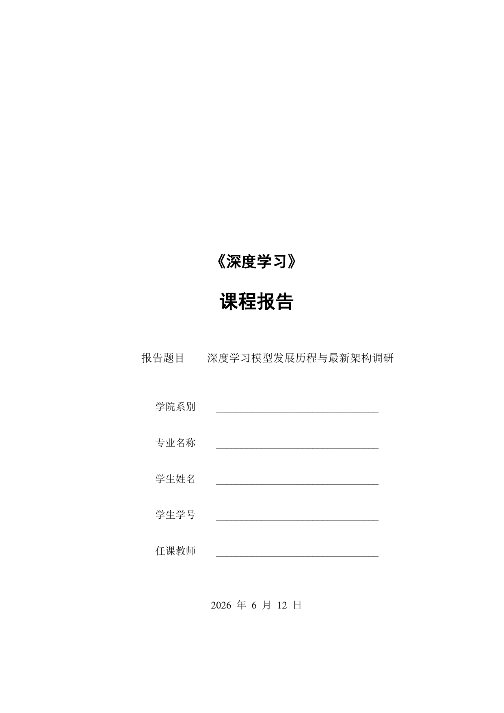</td>
    <td width="50%">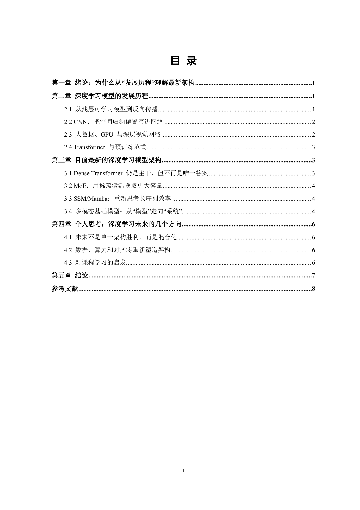</td>
  </tr>
  <tr>
    <td width="50%">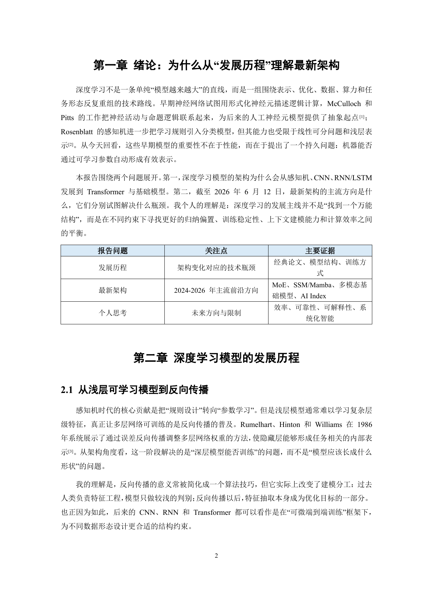</td>
    <td width="50%">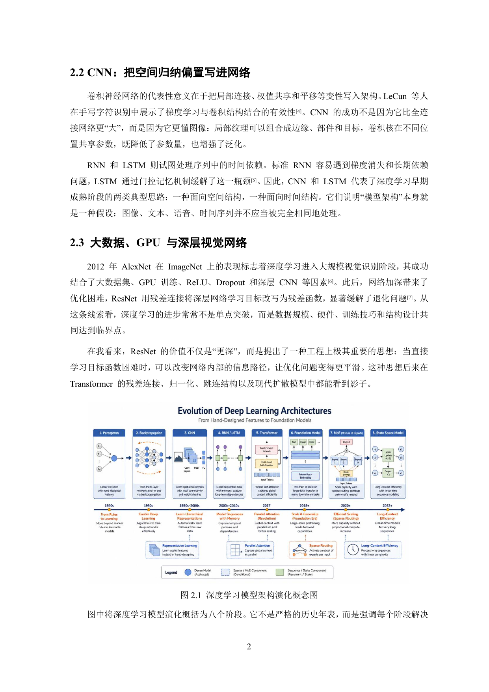</td>
  </tr>
  <tr>
    <td width="50%">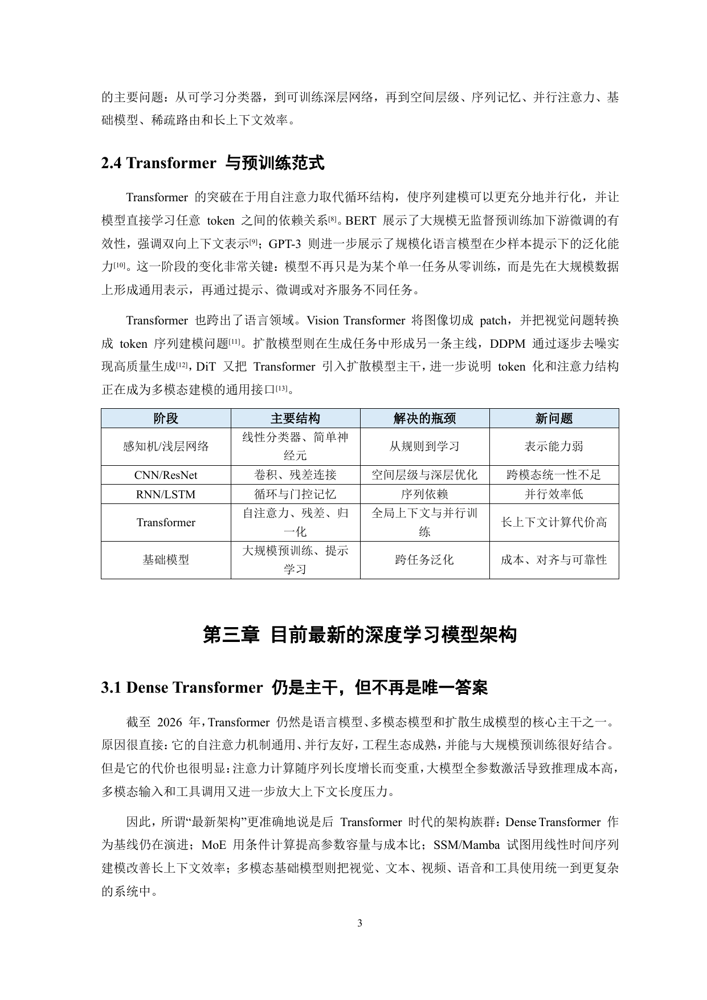</td>
    <td width="50%">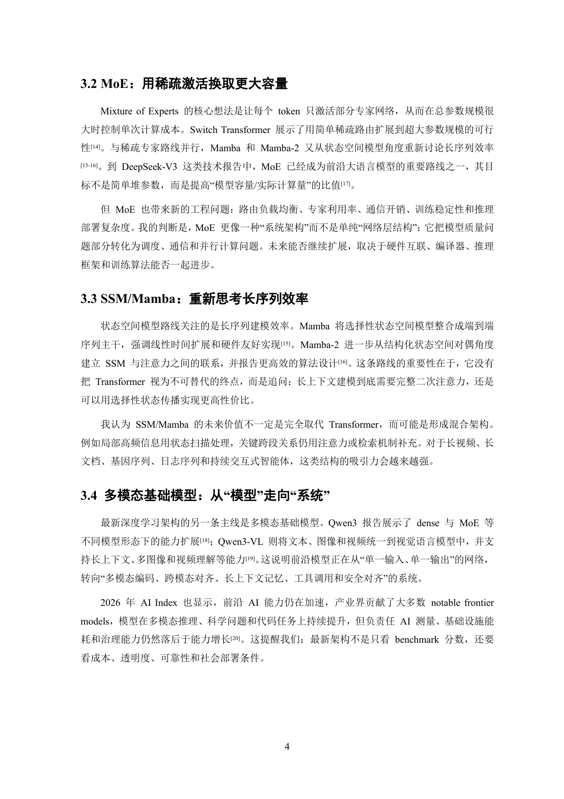</td>
  </tr>
  <tr>
    <td width="50%">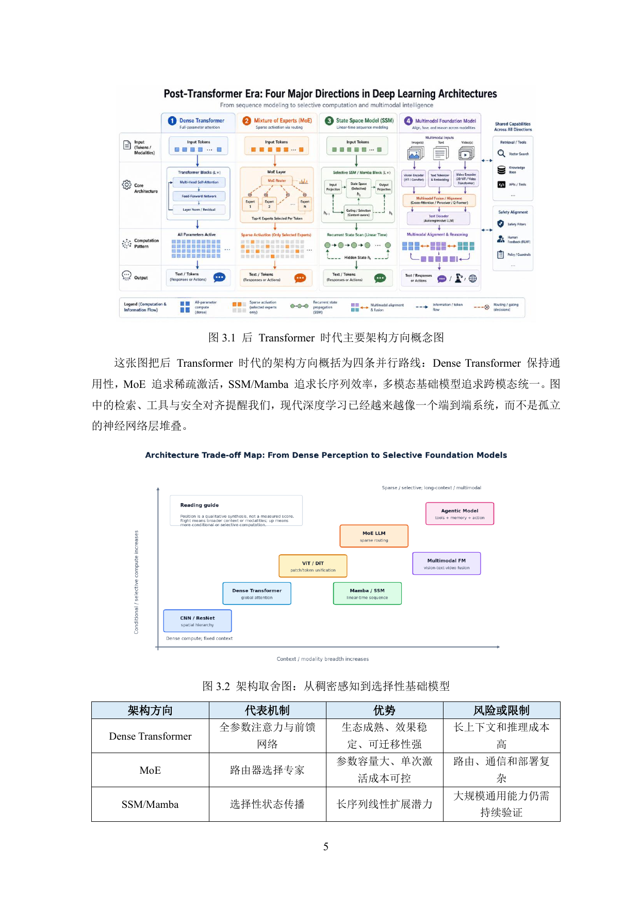</td>
    <td width="50%">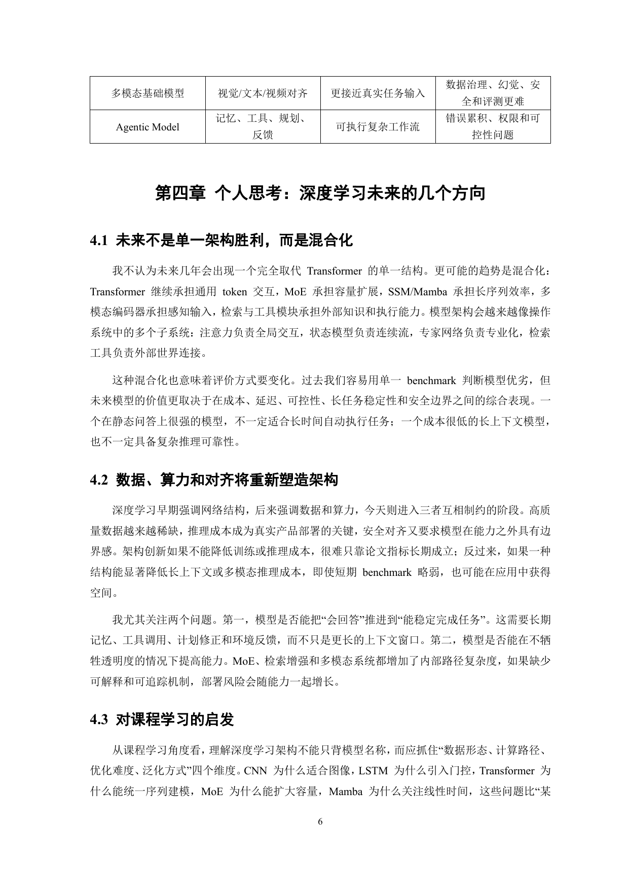</td>
  </tr>
  <tr>
    <td width="50%">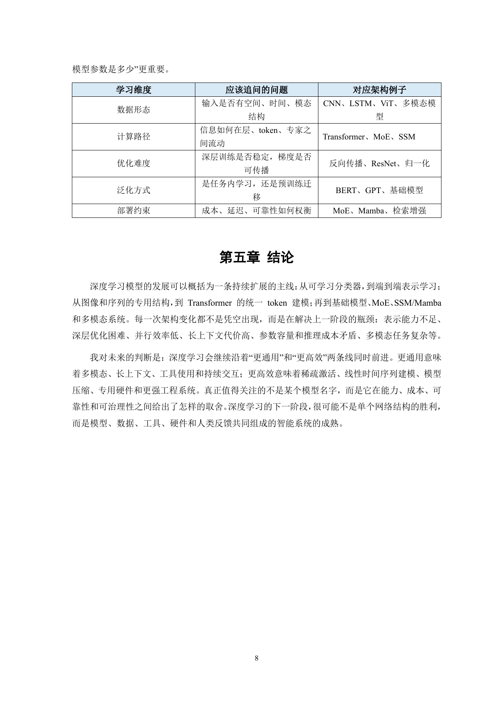</td>
    <td width="50%">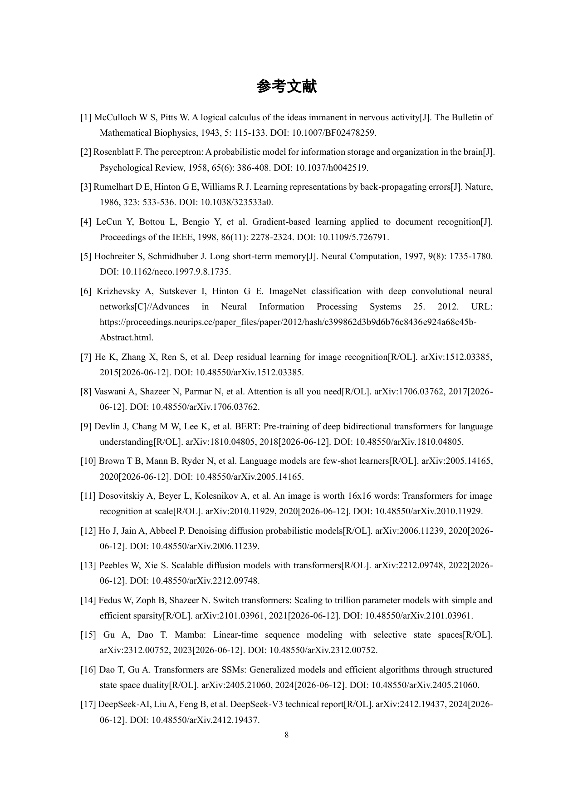</td>
  </tr>
  <tr>
    <td width="50%">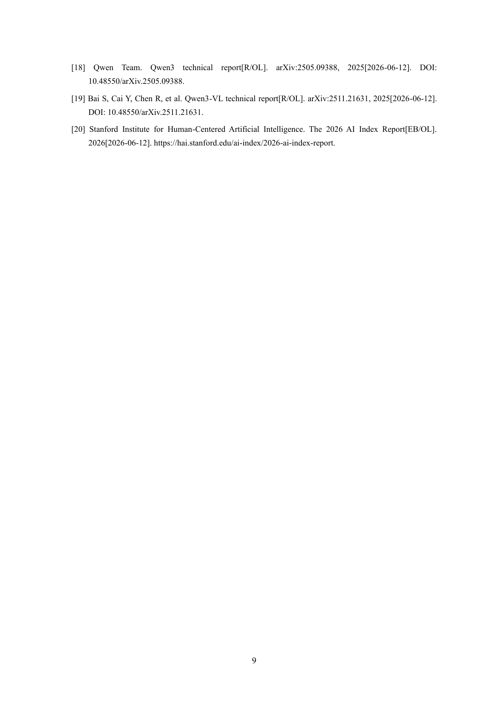</td>
    <td width="50%"></td>
  </tr>
</table>

The deterministic figure showcase now uses the current report's architecture trade-off map:

<p align="center">
  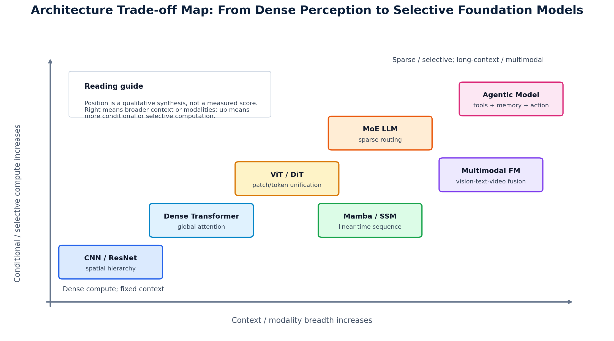
</p>

<a id="features"></a>

## Features

| Feature | Description |
| --- | --- |
| Chinese report generation | DOCX, LaTeX and Typst templates for coursework, lab, paper and review structures |
| Template-first assembly | Uses the user template when provided, otherwise uses the integrated default template |
| Word TOC and field update | Uses real heading styles and automatic Word fields |
| PDF and page-level QA | Uses office export for DOCX or native compilation for LaTeX/Typst; inspects page PNGs, with contact sheets as an index |
| Evidence-first writing | Tracks logs, screenshots, data, scores, filenames, model names, and dates |
| GB/T 7714-2015 references | Uses sequential numeric citations and strictly follows GB/T 7714-2015 by default for course-report references |
| Linux experiment runtime | Uses native Linux, verified WSL on Windows, or an existing VM/remote Linux host on macOS when Linux behavior is required |
| Browser and terminal screenshots | Treats screenshots as first-class evidence, including browser pages, terminal windows, GUI states, and external source pages |
| Diagram and TikZ review | Audits arrows, labels, spacing, semantics, and final scaling |
| Controlled AI images | Asks AI enablement first; if enabled, asks insertion count and editable PPT reconstruction preference |
| Bounded collaboration and review | First-use model/effort disclosure; configurable specialists and independent review for substantial reports; one full review and at most two focused repairs |

<a id="quick-start"></a>

## Quick Start

Install this project into your Codex skills directory:

- macOS: `~/.codex/skills/docx-course-report-writer`
- Windows: `%USERPROFILE%\.codex\skills\docx-course-report-writer`

Back up an existing installation before synchronizing the repository's skill files. Exclude `.git`, `output/`, temporary files, caches and macOS `._*` metadata. The updated skill is available on the next turn.

Use Python 3.10 or newer with the report dependencies (`python3`, `python` or `py -3` as appropriate). PowerShell/Word COM is Windows-only. macOS office export and native compiler commands are in [output-formats.md](references/output-formats.md).

Then invoke it directly in Codex:

```text
Use $docx-course-report-writer to create a Chinese lab report from requirements.md and src/.
Run the code, capture real evidence, and deliver in the selected output format (DOCX, LaTeX→PDF, or Typst→PDF).
Ask me before enabling text-to-image figures and confirm the maximum image count.
```

Recommended inputs:

- Assignment requirements or grading rubric.
- User-provided DOCX, LaTeX or Typst template, if any.
- Code, logs, screenshots, data tables, references, or an existing draft.
- Cover metadata such as name, student ID, course name, teacher, and date.
- Whether DOCX, LaTeX→PDF, Typst→PDF, proof screenshots, charts, appendix, or citations are required.
- If citations are required, expect sequential numeric references that strictly follow GB/T 7714-2015 unless the assignment or template explicitly requires another standard.

<a id="workflow"></a>

## Workflow

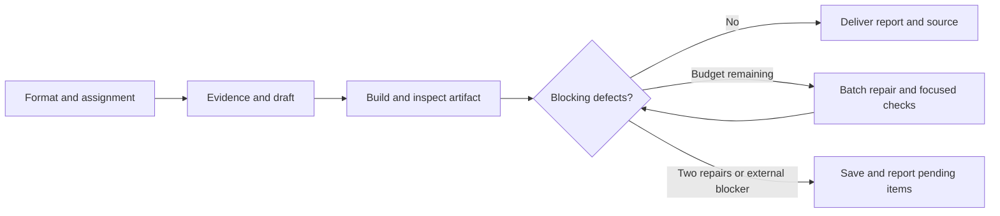

See [`references/workflow.md`](references/workflow.md) for the full workflow.

<a id="superpowers-workflow"></a>

## Superpowers Workflow

Superpowers is optional, not a dependency. Use a relevant workflow only when explicitly requested or needed for a specific problem. Do not add nested plans or review loops.

<a id="actor-critic"></a>

## Bounded Artifact Review

Map assignment requirements to evidence and acceptance checks. The main agent integrates and builds; substantial reports use an enabled, available independent reviewer on the actual artifacts, while small edits use self-review. Verify key claims against source passages/raw results and recompute derived numbers; bibliographic validity alone is insufficient. All reviewers share a maximum of two focused repair rounds; repeated unchanged failures and missing external inputs stop the loop. Unresolved defects stay pending. See [review protocol](references/actor-critic-loop.md).

<a id="wsl-screenshot"></a>

## WSL And Screenshot Highlights

### Skilled Linux/WSL Runtime Handling

When coursework specifically requires Linux behavior, use native Linux, verified WSL on Windows, or an existing Linux VM/remote host on macOS. macOS POSIX support alone does not prove Linux equivalence. Record the actual distribution, kernel, compiler/runtime and build/run/test commands. Missing runtimes remain a documented prerequisite; WSL setup is Windows-only and requires explicit permission. Formatting an existing report reuses saved results rather than rerunning experiments.

This is useful for Linux coursework, C/POSIX labs, sockets, processes, signals, shared memory, semaphores, Makefiles, and Linux-only commands.

### Screenshots As Verifiable Evidence

Screenshots are treated as evidence assets, not decoration. The Skill plans screenshot targets during intake:

- Browser screenshots: verify the intended page and reject 403, login, CAPTCHA, blank, error, or wrong-tab captures.
- Terminal screenshots: prefer real visible terminal captures with command, working directory, key output, and verification result.
- GUI/app screenshots: capture the window region that proves the relevant state.
- Raw and annotated separation: save raw screenshots first, then make cropped or red-box annotated copies.
- Final insertion review: check readability after DOCX/PDF scaling and ensure annotations do not hide proof text.

See [`references/tooling-recipes.md`](references/tooling-recipes.md).

<a id="diagram-qa"></a>

## Diagram QA

Every self-drawn figure, TikZ drawing, flowchart, architecture diagram, mechanism diagram, timeline, or similar visual must enter a final `Review And Revise` stage after rendering.

Required checks:

- No arrow is crossed, hidden, clipped, ambiguous, or pointed at the wrong target.
- No arrow overlaps text, modules, legends, titles, numbering, or captions.
- Labels do not overflow boxes or collide with borders and other labels.
- The final DOCX/PDF-scaled image remains readable, clean, and semantically correct.
- AI-generated images never replace real experimental results, screenshots, or data plots.
- Report-visible figures, captions, paragraphs, and tables do not contain production-process claims about how a figure was made, generated, rendered, or checked. Keep those details in the run record or attribution sidecar.

See [`references/figures-and-diagrams.md`](references/figures-and-diagrams.md).

<a id="default-template"></a>

## Default Template

Use the user's matching template first. Otherwise copy the selected built-in asset:

| Format | Template | Build |
|---|---|---|
| DOCX | [Word template](skill-assets/default-course-report-template.docx) | Existing Python builder and office finalization |
| LaTeX | [main.tex](skill-assets/latex/main.tex) plus bibliography | latexmk / XeLaTeX |
| Typst | [main.typ](skill-assets/typst/main.typ) plus bibliography | Typst |

See [native template mapping](references/native-templates.md) for fonts, metadata and limitations. This is a structural adaptation of the default Word report, not lossless conversion of arbitrary Word templates. The router requires `--format`; the legacy DOCX builder interface remains unchanged.

### User-Template Fidelity

When the user provides a DOCX template, the skill must treat that file as the layout source of truth rather than loose writing inspiration.

Recommended workflow:

1. Copy the user template to the target output path first.
2. Inspect the copied template structure before writing: cover tables, section breaks, margins, styles, TOC position, placeholders, sample body, headers, footers, and media.
3. Replace known placeholders and cover metadata in place.
4. Insert new report content into the copied template without rebuilding page setup or styles from scratch.
5. Remove only stale sample body, stale TOC entries, irrelevant old screenshots, and placeholder paragraphs that are proven to belong to template sample content.
6. Run template-fidelity QA comparing the final DOCX against the source template.

`scripts/build_report.py --template ...` defaults to this copy-first, write-in-place behavior. Destructive body replacement is opt-in through `--drop-template-body`; it must not be used for a user-specified template unless the user explicitly asks for it.

The default builder preserves useful page setup, heading styles, table styling, cover style, and metadata while clearing stale body content, old screenshots, old TOC entries, and unrelated media. After the cover and TOC, it starts the body in a new Word section with page numbering restarted at 1.

<a id="quality-gates"></a>

## Quality Gates

Record **PASS / NEEDS_FIXES / UNVERIFIED** against the actual checked build. Overall PASS requires every applicable mandatory gate to pass:

- Evidence authenticity.
- Key-claim support in source passages/tables or raw results, and recalculated derived values with conditions, units and denominators checked.
- Template residue.
- Linux/WSL runtime verification when Linux/POSIX behavior matters.
- DOCX Word TOC/fields or native-format compilation/references, plus page numbering.
- Cover and TOC layout: the default cover occupies page 1 only, TOC page numbers are right-aligned with formal dot leaders, and cover/TOC pages do not count as body pages or display the body `PAGE` field; the first visible page number 1 must be on the first chapter/body page.
- References: metadata is verified before drafting; in-text citations are superscript numeric references; the final bibliography strictly follows GB/T 7714-2015 by default; if a course requires another standard, the run record must say so explicitly.
- Fact consistency across text, captions, tables, and figures.
- Screenshot authenticity for browser and terminal captures.
- Diagram semantics, arrows, labels, and layout.
- Figure captions: every image has a formal `Figure x.x Title` style caption in the target language, and raw provenance/source lines do not leak into the report body.
- Rendered PDF/page inspection when layout matters. DOCX uses the available office application; LaTeX/Typst use native compilers. Word COM is Windows-only. Use `scripts/render_pdf_review_pages.py` for page PNGs and four-page review sheets. Inspect every page on the initial build and affected pages after repairs; sheets are an index. Treat `BLANK_PAGE` as blocking unless intentional and documented.
- Analysis depth for experiment-heavy reports.

See [`references/report-qa-checklist.md`](references/report-qa-checklist.md).

<a id="project-structure"></a>

## Project Structure

```text
docx-course-report-writer/
├─ SKILL.md
├─ README.md
├─ README.en.md
├─ assets/
│  └─ logo.png
├─ skill-assets/
│  ├─ default-course-report-template.docx
│  ├─ latex/                  # main.tex + references.bib
│  ├─ typst/                  # main.typ + references.bib
│  ├─ report-draft-template.md
│  ├─ references-template.md
│  └─ image-attributions-template.md
├─ references/
│  ├─ workflow.md
│  ├─ multi-agent-workflow.md
│  ├─ actor-critic-loop.md
│  ├─ ppt-figure-reconstruction.md
│  ├─ figures-and-diagrams.md
│  ├─ report-qa-checklist.md
│  └─ ...
├─ scripts/
│  ├─ build_report.py
│  ├─ check_environment.py
│  ├─ route_report_output.py
│  ├─ vector_figure.py
│  ├─ qa_docx_report.py
│  ├─ render_pdf_review_pages.py
│  ├─ update_word_fields.ps1
│  └─ annotate_screenshot.py
└─ docs/
   ├─ deep-learning-architecture-report-demo.docx
   ├─ deep-learning-architecture-report-demo.pdf
   ├─ deep-learning-report-page-01.png
   ├─ ...
   ├─ deep-learning-report-page-11.png
   ├─ deep-learning-architecture-tradeoff-map.png
   └─ testing-report.md
```

<a id="examples"></a>

## Examples

- Sample DOCX: [`docs/sample-report.docx`](docs/sample-report.docx)
- Sample PDF: [`docs/sample-report.pdf`](docs/sample-report.pdf)
- Testing notes: [`docs/testing-report.md`](docs/testing-report.md)
- Historical failures and fixes: [`docs/historical-failures.md`](docs/historical-failures.md)
- Backend evaluation notes: [`docs/backend-evaluation.md`](docs/backend-evaluation.md)
- Platform support matrix: [`docs/platform-support.md`](docs/platform-support.md)

<a id="faq"></a>

## FAQ

### What if no template is provided?

The Skill uses the built-in template for the selected format (DOCX, LaTeX or Typst). A matching user template takes priority.

### Can it insert AI-generated images?

Yes. Ask enablement first; only if enabled ask insertion count and whether to reconstruct as editable PPT objects. Keep PPTX/PDF and verify final report vector preservation when reconstruction is selected. AI images are only for explanatory or conceptual use.

### How does it reduce token use?

Read format-specific material only, delegate distinct useful tasks within concurrency/task caps, reuse verified evidence, and assign one reviewer to the full artifact. Batch defects and review affected content after repairs. Models, efforts and the disable option are in [collaboration settings](references/multi-agent-workflow.md). A shorter entrypoint is measurable; end-to-end token savings have not been benchmarked, and delegation does not guarantee lower total token use or a better pass rate.

### Why emphasize arrows?

Flowcharts and TikZ diagrams often fail because arrows cross, overlap text, or become unclear after scaling into Word. This Skill treats arrow review as a required quality gate.

## Design References

The README layout, language entry, and quick navigation are inspired by [`luongnv89/claude-howto`](https://github.com/luongnv89/claude-howto). The planning, execution, debugging, and verification workflow is aligned with [`obra/superpowers`](https://github.com/obra/superpowers).

## Star History

[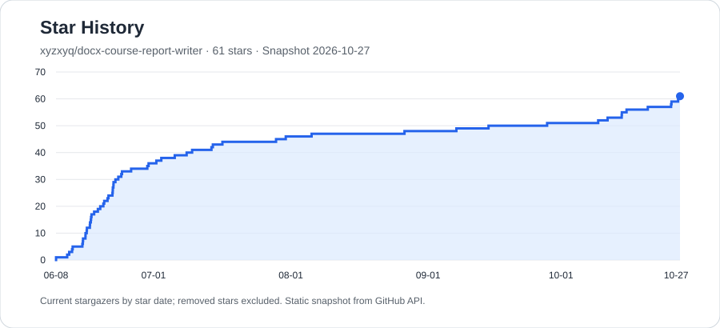](https://github.com/xyzxyq/docx-course-report-writer/stargazers)

**61 stars as of 2026-10-27.** [GitHub API data](docs/star-history.json), accumulated by the star dates of current stargazers. Removed stars are excluded; this is not a historical net-total series. The chart is a dated static snapshot, not a live feed. The hosted image endpoint currently refuses this repository, so this SVG is served directly from the repository.
