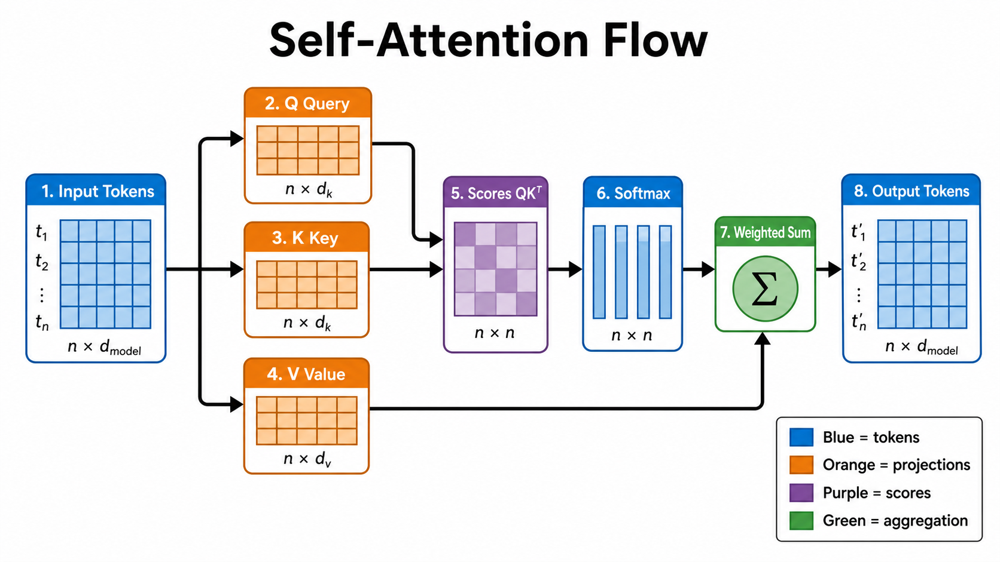
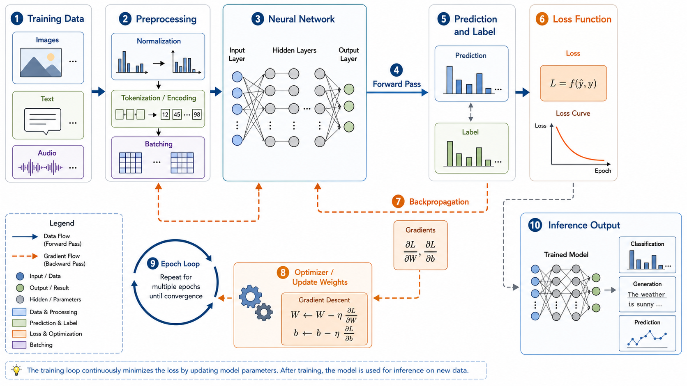
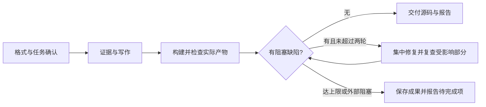

<p align="center">
  
</p>

<h1 align="center">Course Report Writer · DOCX / LaTeX / Typst</h1>

<p align="center">
  <em>“没有什么比一件未完成的任务一直挂在那里更令人疲惫。”</em>
  <br>
  <sub>William James，1886。每个被课程报告追杀的大学生都懂。</sub>
</p>

<p align="center">
  面向大学生水课课程报告、实验报告、课程论文与综述写作的 Codex Skill。
  <br>
  这是一个被本学期过量课程报告逼出来的自动化工作流。
  <br>
  支持 DOCX、LaTeX 与 Typst，将证据、写作、排版与交付检查放在同一流程中。
</p>

<p align="center">
  <a href="#quick-start"></a>
  <a href="#demo"></a>
  <a href="#quick-start"></a>
  <a href="#highlights"></a>
  <a href="#subagent-settings"></a>
  <a href="README.en.md"></a>
</p>

<p align="center">
  
  
</p>

---

## 当前优化状态

支持 DOCX、LaTeX、Typst 三种报告源格式；未指定时必须先询问，已指定则不重复确认。LaTeX/Typst 交付可编辑源码和 PDF，内置模板见下表。

默认由主 agent 统稿；复杂报告按需分派资料/专项任务与独立终审，小改动直接处理。首次使用告知 subagent 的模型、思考强度和并发上限，用户可调整或关闭，具体见[协作设置](references/multi-agent-workflow.md)。只进行一次完整检查，最多两轮集中修复；达到上限仍有缺陷时标记待完成。Superpowers 可选。已验证范围与限制见[平台矩阵](docs/platform-support.md)和[使用说明](references/output-formats.md)。

当前 **59 项自动测试全部通过**，包括12项占位符保真回归及实际编译PDF的Typst中文行距检查。占位符替换保留非目标格式、图片、字段和链接，遇到复杂边界明确拒绝；Typst默认正文基线距调整为约17pt，并放宽标题与文献间距。三格式真实报告见下方样例。此前12个只读情景推演保留为历史记录；Word/WPS最终外观、Windows和真实质量/速度A/B仍未验证。详见[本轮修复记录](docs/verification-2026-10-27.md)与[历史验证](docs/verification-2026-10-23.md)。安装标识仍为 `docx-course-report-writer`。

<a id="multiformat-demo"></a>

## 本次产出：多智能体协作研究综述

同一份约5,138字、5章、14条参考文献的报告，分别使用三种格式构建。点击PDF阅读完整报告，源码目录包含参考文献与插图。

| 格式 | 报告 | 可编辑源 | 状态 |
|---|---|---|---|
| **DOCX** | [Word文档](examples/multiagent-report/report.docx) · [PDF预览](examples/multiagent-report/report-docx-preview.pdf) | DOCX本身 | 正文与图文检查通过；**自动目录仍待更新，不是提交定稿** |
| **LaTeX** | [11页PDF](examples/multiagent-report/report-latex.pdf) | [LaTeX项目](examples/multiagent-report/latex) | 原生编译与独立逐页审查通过 |
| **Typst** | [10页修订PDF](examples/multiagent-report/report-typst.pdf) | [Typst项目](examples/multiagent-report/typst) | 已修复密排；逐页布局自查与行距回归通过 |

| DOCX正文（LibreOffice预览） | LaTeX正文 | Typst正文（修订后） |
|---|---|---|
| [](examples/multiagent-report/report-docx-preview.pdf) | [](examples/multiagent-report/report-latex.pdf) | [](examples/multiagent-report/report-typst.pdf) |

Typst按用户反馈将正文实测行距从12.02pt调整为17.00pt，页数由9页变为10页；正文、引文与图片不变。图源另附[可编辑PPTX](examples/multiagent-report/figures/collaboration.pptx)与[矢量PDF](examples/multiagent-report/figures/collaboration.pdf)。这是概念图与文献综述，不是模型性能复现实验。完整范围、构建方法与限制见[样例说明](examples/multiagent-report/README.md)。

<a id="subagent-settings"></a>

## 默认 subagent 配置

| 任务 | 默认模型 | 思考强度 |
|---|---|---|
| 资料核验、图表等专项任务 | `gpt-6.1-sol` | `medium` |
| 独立终审 | `gpt-6.1-sol` | `high` |

首次撰写报告时会先核对宿主能力、告知设置，并提供调整或关闭选项；已明确的偏好记录在项目中并沿用。主 agent 的模型设置不变。模型不可用时说明限制，不静默替换；宿主未返回实际运行配置时，不把请求参数当作运行确认。

默认最多并发 **2 个 subagent**、每份报告最多 **3 个专项/审阅任务**，受宿主容量限制。主 agent 统一论证、术语、数值与引用；独立 reviewer 负责一次完整审查，所有角色共享最多两轮修复。配置是可调整的起点，不代表已证实最优速度或准确率；完整规则以[协作工作流](references/multi-agent-workflow.md)为准。

## 开始前的 skill 选择与交互

智能体先根据任务检查本机已安装、可用的 skill，只加载确有帮助的部分。例如 `nature-academic-search` 用于文献检索与引文核验，`nature-writing` 用于写作，`nature-polishing` 用于润色，`nature-image2ppt` 用于可编辑 PPT 复现。它们是可选能力，不是必须安装或依次调用的流水线，也不会自动把课程报告改成 Nature 期刊风格。

询问格式时，须向用户说明取舍：

| 格式 | 优点 | 局限 |
|---|---|---|
| DOCX | Word/WPS 编辑方便，适合学校模板与协作修改 | 跨软件分页/字体/目录可能变化，复杂公式引用需维护 |
| LaTeX | 公式、引用、长文档排版强，PDF 稳定 | 有语法和编译门槛，不能直接套用 Word 模板 |
| Typst | 语法较简洁，编译预览方便 | 模板生态较小，与 Word/LaTeX 不直接兼容 |

先问是否需要 AI 插图；选“否”就跳过后续问题。选“是”再问数量，以及是否用 PPT 原生对象复现、导出 PDF 并插入报告。PPT 复现适合流程图/架构图，但需要额外工作；照片和纹理可能仍为位图。用户已明确的选择不再重复询问。

选择复现后交付 **可编辑 PPTX + 导出的 PDF + 报告**。DOCX 构建器已支持单页 PDF 和自包含静态 SVG 插图：在运行脚本的 Python 环境安装可选依赖 `PyMuPDF`，继续使用 `` 或 ``。PDF 会转换为 SVG，DOCX 同时保存 SVG 与 PNG 兼容预览；是否保留矢量仍需检查实际软件导出的报告 PDF。不能声称图片放进 PPT/PDF 就变成矢量，或声称 Word 内可逐对象编辑。详见[询问流程](references/intake-and-run-record.md)、[插入与验证流程](references/ppt-figure-reconstruction.md)和[Transformer 实测记录](docs/verification-2026-10-23.md#transformer-vector-figure-end-to-end-run)。

## 它解决什么问题？

大学水课很多，课程报告也很多。真正消耗人的不是某一篇报告，而是一学期里反复出现的“查资料、凑结构、配图、写格式、调目录、导 PDF、再返工”。这个 Skill 就是为这种场景做的：让重复性课程报告尽量自动化，将正文、所选格式的构建和交付检查一起完成。

很多课程报告不是“写不出来”，而是交付前容易在这些地方翻车：

| 报告问题 | Skill 的处理方式 |
| --- | --- |
| 内容看似完整，但没有证据链 | 先建立事实台账，再写结论；运行日志、截图、引用和数据必须可追踪 |
| Word 目录、页码、字段没更新 | 使用真实 Word 标题样式，Windows 下优先 Word COM 更新字段并导出 PDF |
| 封面、模板、旧内容残留 | 使用模板优先策略，并检查占位符、旧主题、旧截图和乱码 |
| 参考文献看似完整但信息不准 | 写作前建立引用元数据台账；默认使用并严格遵循 GB/T 7714-2015 顺序编码制，完成 DOI/权威来源核验后再排版 |
| 图表插进去后不专业 | 强制正式图注、图号顺序、箭头/文字布局审查和 PDF 页面级 QA |
| AI 图片被误当证据 | AI 图只作概念解释；来源、prompt 和非证据属性写入旁路记录 |

`docx-course-report-writer` 输出报告及所需可编辑源码、素材与核验记录，支持课程提交和后续修订。验收针对已知作业要求，不保证教师评分。

<a id="demo"></a>

## 示例展示：深度学习架构课程报告

下面的示例来自一次完整生成的历史课程报告。它展示了这个 Skill 会关注的细节：封面只占第一页、目录页码右对齐、图注使用 `图x.x` 正式编号，参考文献默认遵循 GB/T 7714-2015，正文不泄漏原始制图来源或工艺说明，最终 PDF 每一页都经过页面级渲染检查。历史示例不代表本次已重新完成 Windows 验证。

| 文件 | 说明 |
| --- | --- |
| [`deep-learning-architecture-report-demo.docx`](docs/deep-learning-architecture-report-demo.docx) | 已上传到 GitHub 的修订版 Word 示例产出 |
| [`deep-learning-architecture-report-demo.pdf`](docs/deep-learning-architecture-report-demo.pdf) | 已上传到 GitHub 的 Word COM 导出 PDF 示例产出 |
| [`deep-learning-report-page-01.png`](docs/deep-learning-report-page-01.png) - [`deep-learning-report-page-11.png`](docs/deep-learning-report-page-11.png) | 当前报告逐页 PDF 渲染预览 |

### 当前报告逐页预览

<table>
  <tr>
    <td width="50%"></td>
    <td width="50%"></td>
  </tr>
  <tr>
    <td width="50%"></td>
    <td width="50%"></td>
  </tr>
  <tr>
    <td width="50%"></td>
    <td width="50%"></td>
  </tr>
  <tr>
    <td width="50%"></td>
    <td width="50%"></td>
  </tr>
  <tr>
    <td width="50%"></td>
    <td width="50%"></td>
  </tr>
  <tr>
    <td width="50%"></td>
    <td width="50%"></td>
  </tr>
</table>

### AI 架构图：一次文生图合格示例

2026-06-11 的实践暴露了一个关键问题：只写“深度学习、神经网络、科技感、未来感、发光线条”会生成很多视觉资产，但观众很难判断图到底在讲 CNN、Transformer、训练流程还是部署系统。Skill 现在要求先设计信息架构，再设计视觉风格。

对于直接插入 AI 位图的路线，架构图、示意图、流程图、pipeline 图和模型结构图的最终 AI 生成图必须一次性直接包含可读文字、具名模块、方向箭头、图例和分层关系。不允许先生成无字底图，再用 Pillow/SVG/TikZ/PowerPoint 或其他工具补字、补箭头、补图例。如果文生图的文字、箭头或图例不合格，直接位图路线需重新生成或改用确定性图。用户选择 PPT 复现时，可以直接在原生 PPT 对象中重建并纠正文字、形状和箭头；这一路线不受上述直接位图补字限制。

<p align="center">
  
</p>

这张图是一次文生图直接生成的验收样例：它解释 `Self-Attention` 加权求和知识点，包含 `Input Tokens`、`Q Query`、`K Key`、`V Value`、`Scores QK^T`、`Softmax`、`Weighted Sum`、`Output Tokens` 等具名模块，并用箭头和图例表达方向关系与颜色语义。

### 新绘图策略：知识结构驱动，而不是科技海报

2026-06-12 的深度学习课程报告实践进一步暴露了文生图 prompt 的根本问题：主题驱动 prompt 会自动滑向“神经网络节点、蓝色发光线路、服务器、芯片、数据流、透明模块”的 AI 视觉模板，画面复杂但信息空心。现在 Skill 将文生图 prompt 重构为知识结构驱动：先定义一张图只回答的一个核心问题，再列出必须出现的知识模块、方向关系、标签、图例和禁止装饰。

下面是新策略生成的训练流程教学信息图。它不是“关于深度学习的高级科技图”，而是明确解释训练数据、预处理、神经网络、前向传播、预测与标签、损失函数、反向传播、优化器更新、训练循环和推理输出之间的关系。

<p align="center">
  
</p>

对于确定性图，Skill 现在要求先判断图的任务：流程、时间线、模型架构和模块关系图应优先选择可控、可复现、可审查的绘图方式；真实数据图表、热力图、图像拼接和数值驱动可视化则优先使用数据绘图工具。无论采用哪种方式，最终报告中只保留帮助读者理解内容的图形、标签和正式图注，不在正文或图中写入制图过程、编码方式、渲染工具等工艺说明。

<p align="center">
  
</p>

这两张图的验收重点不同：文生图示例检查“是否摆脱空泛科技海报、是否具备知识模块和语义密度”；确定性图示例检查“位置关系是否解释架构取舍、标签是否清晰、缩放后是否仍然可读”。

<a id="highlights"></a>

## 亮点

### 1. Source-first，不凭空写结果

报告先做 evidence plan：任务要求、运行命令、日志、截图、数据、文件名、模型名、引用来源和最终结论都进入事实台账。没有真实证据的结论会被标成限制或推断。

### 2. Word-first，避免“看起来像目录”的假目录

生成器使用真实 Word 标题样式和自动目录字段；Windows 下通过 Word COM 更新目录、页码、字段并导出 PDF。目录页码右对齐、参考文献分页、封面单页都作为验收条件。

### 3. 有上限的检查与修复

默认流程：按作业要求建立“要求—证据—验收”对应关系 → 主 agent 统稿与构建 → 复杂报告由可用的独立 reviewer 检查真实产物 → 集中修复并复查受影响部分，最多两轮。小改动由主 agent 自查；多人协作可关闭。关键论断核验到原文/原始结果，派生数字复算，不能只验证文献是否存在。证据缺失、工具不可用或同一失败重复时停止并说明阻塞，不把未验证项标记为通过。

### 4. 图表不是装饰，是可读性工程

流程图、架构图、时间线、TikZ 图、自绘图和 AI 概念图都要经过 Review And Revise。重点检查箭头、文字压框、图号、图注、缩放后的清晰度，以及是否误把概念图写成证据。

### 5. 对中文课程项目友好

默认中文报告结构、中文封面、中文图注、中文 QA 规则，并按 Windows/macOS、所选格式和已安装工具选择构建路径；Word COM 与 WSL 仅适用于对应的 Windows 场景。

<a id="quick-start"></a>

## 快速开始

### 无需额外工作流插件

Superpowers 不是运行前提；有具体需求或用户明确指定时再调用。格式专用说明按需加载，不默认展开全部历史经验与角色提示词。

### 安装

将仓库放入 Codex skills 目录：

- macOS：`~/.codex/skills/docx-course-report-writer`
- Windows：`%USERPROFILE%\.codex\skills\docx-course-report-writer`

更新已有安装时先备份，再同步仓库的 skill 文件；排除 `.git`、`output/`、临时文件、缓存与 macOS `._*` 元数据。更新后的 skill 在下一轮调用时可用。

脚本使用安装了所需依赖的 Python 3.10 或更新版本；macOS 常用 `python3`，Windows 常用 `python` 或 `py -3`。PowerShell/Word COM 仅用于 Windows 的 Word 定稿。macOS 可用现有 Word/WPS 或 LibreOffice 导出后检查，详见[输出路由](references/output-formats.md)。

在 Codex 中点名使用：

```text
请使用 $docx-course-report-writer，根据 assignment.md、template.docx 和 src/ 生成中文实验报告。
需要真实运行、截图，按任务要求输出 DOCX（可转 PDF）或 LaTeX→PDF / Typst→PDF，并在交付前做页面渲染复核。
```

### 推荐输入

| 输入 | 为什么需要 |
| --- | --- |
| 课程要求 / rubric | 锁定评分点和报告结构 |
| DOCX / LaTeX / Typst 模板 | 用户模板优先；未提供时使用所选格式的内置模板 |
| 代码、日志、截图、数据 | 形成证据链，避免编造实验结果 |
| 参考文献或论文链接 | 支撑综述、课程论文和技术事实；默认采用并严格遵循 GB/T 7714-2015 |
| 姓名、学号、课程名、教师名 | 生成正式封面 |
| 是否允许 AI 图片；启用后的数量与 PPT 复现选择 | 分支询问、复用已明确答案，不能静默默认 |

<a id="workflow"></a>

## 工作流



完整流程见 [`references/workflow.md`](references/workflow.md)。

## 默认模板与生成器

用户提供的对应格式模板优先；未提供时使用：

| 格式 | 内置模板 | 构建 |
|---|---|---|
| DOCX | [Word 模板](skill-assets/default-course-report-template.docx) | 现有 Python 构建器 + 办公软件定稿 |
| LaTeX | [main.tex](skill-assets/latex/main.tex) + 同目录 `.bib` | latexmk / XeLaTeX |
| Typst | [main.typ](skill-assets/typst/main.typ) + 同目录 `.bib` | Typst |

原生模板对应 Word 的封面字段、A4、25.4 mm 页边距、自动目录、正文页码重置和章节图表编号。字体与版式映射见[模板说明](references/native-templates.md)，不保证任意 Word 模板跨格式无损转换。先复制模板目录再修改；只有用户明确要求时才省略封面或使用空白文档。

```sh
python scripts/route_report_output.py --format latex --source reports/main.tex --output output/report.pdf
python scripts/route_report_output.py --format typst --source reports/main.typ --output output/report.pdf
```

`--format` 必填；编译失败保留已有成品。该路由编译原生项目，不自动把 Markdown 或 DOCX 转成 LaTeX/Typst。

### 用户模板保真

当用户提供 DOCX 模板时，Skill 必须把该模板视为版式事实来源，而不是只参考写作思路。

推荐流程：

1. 先复制用户模板到目标输出路径。
2. 写入前检查复制后的模板结构：封面表格、分节符、页边距、样式、目录位置、占位符、示例正文、页眉页脚和媒体。
3. 原位替换已知占位符和封面元数据。
4. 在复制模板中插入新报告内容，不重新创建页面设置或样式体系。
5. 只删除已确认属于模板示例内容的旧正文、旧目录项、无关旧截图和占位段落。
6. 用模板保真 QA 对比最终 DOCX 与源模板。

`scripts/build_report.py --template ...` 默认采用上述复制模板并原位写入的策略。破坏性清空模板正文只允许通过 `--drop-template-body` 显式开启；用户指定模板时，除非用户明确要求，否则不得使用。

默认构建器会：

- 填充封面元信息，移除 `放置`、`校徽`、`《XXXX》` 等占位符。
- 将封面压缩到第一页，避免日期或空白封面内容溢出到第二页。
- 生成真实 Word Heading 和自动 TOC 字段，并在目录后用新 section 让正文页码从 1 开始。
- 使用 `图<章号>.<序号>` 形式生成正式图注。
- 默认不把原始来源行渲染进正文，来源信息放入 sidecar 文件。
- 在 `参考文献` 前插入分页。

## QA 命令示例

以下 Python 命令可用于 Windows/macOS；按环境将 `python` 替换为 `python3` 或 `py -3`，并只选择适用于当前报告的检查项：

```sh
python scripts/qa_docx_report.py --docx report.docx --require-toc --require-cover --require-body-page-start-1 --require-reference-pagebreak --require-superscript-citations --require-formal-figure-captions --forbid-image-source-lines
```

Windows Word 字段更新与 PDF 导出（仅限 Windows；macOS 路径见[输出路由](references/output-formats.md)）：

```powershell
powershell.exe -NoProfile -ExecutionPolicy Bypass `
  -File scripts\update_word_fields.ps1 `
  -DocxPath report.docx `
  -ExportPdf `
  -UseAsciiTemp
```

PDF 页面渲染审查：

```sh
python scripts/render_pdf_review_pages.py --pdf report.pdf --pages-dir build/pdf-pages --sheets-dir build/pdf-review-sheets --dpi 150
```

该脚本会把最终 PDF 渲染为逐页 PNG，并每四页合成一张审查拼图。它不是终端/浏览器截图，而是 PDF 页面渲染图，适合检查课程报告最终提交/打印时的真实版面。

默认情况下，脚本还会输出每页墨迹率并进行近空白页检测；出现 `BLANK_PAGE` 会以非零状态退出。只有模板或任务明确需要空白页时，才应记录页码和原因后使用 `--allow-blank-pages`。

<a id="quality-gates"></a>

## 质量门

按作业要求记录 **PASS / NEEDS_FIXES / UNVERIFIED**，并绑定实际检查的产物版本；仅当适用的必需项全部通过时才给出整体 PASS：

- 真实证据：实验结果、截图、数据、日志和引用不能凭空编造。
- 论断与计算：关键结论对应原文段落/表格或原始数据；复算派生数字，核对条件、单位、分母和适用范围。
- 模板卫生：无旧主题、旧截图、旧目录、占位符和乱码。
- 封面与目录：封面只占第一页，目录页码右对齐，字段已更新；封面和目录页不计入正文页数，也不显示正文页码字段，正文第一页必须从 1 开始。
- 图注规范：所有插图都有正式 `图x.x 标题`。
- 图像语义：箭头、标签、布局、缩放后的可读性通过审查。
- 参考文献：写作前完成 DOI/权威元数据核验，正文为上标 `[1]` 顺序编码，文后默认并严格遵循 GB/T 7714-2015 排版并检查字体字号；如课程另有标准，必须在运行记录中明确说明。
- PDF 渲染：DOCX 使用可用办公软件更新/导出，LaTeX/Typst 原生编译；首次构建逐页检查，拼图仅作索引。修复后检查受影响页面与下游分页。Windows Word COM 不适用于 macOS。
- 分析深度：实验报告必须有结果分析、失败原因、局限和个人理解。

完整清单见 [`references/report-qa-checklist.md`](references/report-qa-checklist.md)。

## 项目结构

```text
docx-course-report-writer/
├─ SKILL.md
├─ README.md
├─ README.en.md
├─ assets/
│  └─ logo.png
├─ skill-assets/
│  ├─ default-course-report-template.docx
│  ├─ latex/                  # main.tex + references.bib
│  ├─ typst/                  # main.typ + references.bib
│  ├─ report-draft-template.md
│  ├─ references-template.md
│  └─ image-attributions-template.md
├─ references/
│  ├─ workflow.md
│  ├─ multi-agent-workflow.md
│  ├─ actor-critic-loop.md
│  ├─ ppt-figure-reconstruction.md
│  ├─ figures-and-diagrams.md
│  ├─ windows-word-fields.md
│  └─ report-qa-checklist.md
├─ scripts/
│  ├─ build_report.py
│  ├─ check_environment.py
│  ├─ route_report_output.py
│  ├─ vector_figure.py
│  ├─ qa_docx_report.py
│  ├─ render_pdf_review_pages.py
│  ├─ update_word_fields.ps1
│  └─ annotate_screenshot.py
├─ examples/
│  └─ sample-report/
└─ docs/
   ├─ deep-learning-architecture-report-demo.docx
   ├─ deep-learning-architecture-report-demo.pdf
   ├─ deep-learning-report-page-01.png
   ├─ ...
   ├─ deep-learning-report-page-11.png
   └─ deep-learning-architecture-tradeoff-map.png
```

## 常见问题

### 没有课程模板怎么办？

使用所选格式的内置模板：DOCX、LaTeX 或 Typst。填写封面并替换示例内容后构建与检查。

### 可以插入 AI 图片吗？

可以。先询问是否开启；开启后再询问最终插入数量和是否需要 PPT 可编辑复现。复现时保留 PPTX/PDF，并验证报告中的矢量保留情况。AI 图片只能作为概念或解释性插图，不能替代真实实验截图、数据图或运行结果。

### 为什么要导出 PDF？

DOCX 包结构通过不等于页面排版通过。目录、图表、表格、代码块和封面是否真的好看，必须看 Word 更新后的 PDF 或页面渲染。

### 如何减少 token 消耗？

按格式加载资料；仅分派有独立价值的任务，限制并发和任务总数；共享已核验的证据，由一位 reviewer 完成整体验收；集中修复并只重查受影响内容。模型、思考强度和关闭选项见[协作设置](references/multi-agent-workflow.md)。入口文本缩短不等于已测得实际 token 节省比例，多人协作也不保证降低总 token 或提高合格率。

## 参考

- [`SKILL.md`](SKILL.md)：Skill 入口和强制运行契约。
- [`references/workflow.md`](references/workflow.md)：端到端报告工作流。
- [`references/figures-and-diagrams.md`](references/figures-and-diagrams.md)：图表、AI 图片、箭头和图注规范。
- [`references/windows-word-fields.md`](references/windows-word-fields.md)：Word COM、目录字段和 PDF 导出。
- [`docs/testing-report.md`](docs/testing-report.md)：测试与验证记录。
- [`docs/platform-support.md`](docs/platform-support.md)：平台 × 格式支持矩阵（含限制与待验证项）。
- [`docs/backend-evaluation.md`](docs/backend-evaluation.md)：三种后端路线对照与默认路由决策记录。

## Star History

[](https://www.star-history.com/#xyzxyq/docx-course-report-writer&Date)

采用 [Star History](https://github.com/star-history/star-history) 官方趋势图。[GitHub Actions](https://github.com/xyzxyq/docx-course-report-writer/actions/workflows/star-history.yml) 每天北京时间 **08:17（UTC 00:17）** 自动拉取并更新，也支持手动运行；图表未变化时不产生提交。下载或校验失败时保留上次有效图，运行状态可在 Actions 中查看。调度可能延迟，显示数据也受上游缓存影响。 公开仓库连续60天无活动时，GitHub会暂停定时任务，需在 Actions 中重新启用。
