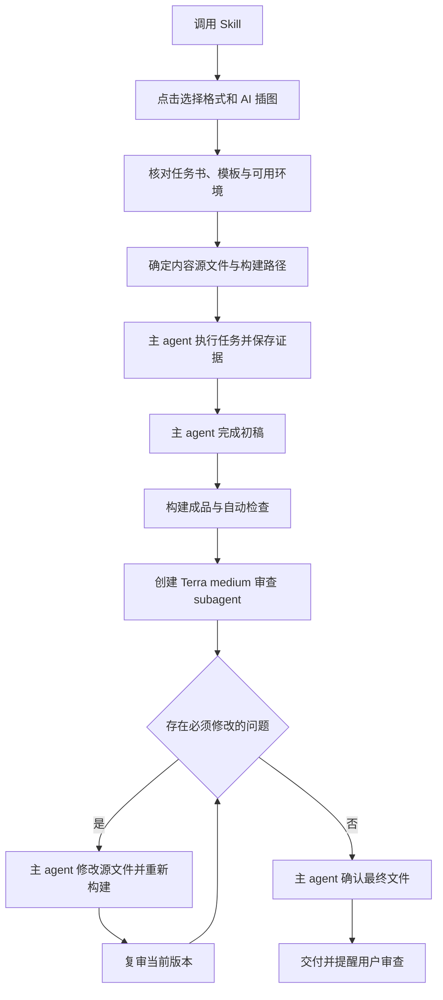

# 课程报告 Skill 优化设计与实施交接书

> 历史设计记录（2026-09-11）。模型、审阅轮次和构建方案已由后续实现调整；当前规则以 [SKILL.md](../SKILL.md) 和[协作工作流](../references/multi-agent-workflow.md)为准，验证范围见[2026-10-23 记录](verification-2026-10-23.md)。保留本文用于追溯，不作为当前执行指令。

日期：2026-09-11
项目：`docx-course-report-writer`
交接基线：`8375784`（接手时重新检查工作区和提交状态）
文档状态：用户已确认的需求与优化设计；技术选型仍须按本文实测。

## 1. 交接目的与执行原则

将当前以 Windows/DOCX 为中心的课程报告 Skill，优化为支持 Windows、macOS，以及 DOCX、LaTeX PDF、Typst PDF 的 agent 工作流。

接手 agent 应先阅读本文和当前仓库，再按阶段实施。本文独立包含需求、约束、决策方法和验收条件，不要求接手 agent 拥有此前对话。

- 主 agent 使用调用者当前模型执行任务、撰写报告和修改报告。
- 优先复用成熟工具；在对照验证前，不扩建通用 Markdown 解析器或自定义文档中间语言。
- 保留现有 DOCX 模板能力和旧命令入口，采用渐进改造。
- 跨平台适配、三种格式、可点击询问、独立审查均为目标范围，不能自行缩减为只输出 PDF。
- 技术选型由真实样例决定；Quarto 是优先评估对象，不是已批准的无条件依赖。
- 按阶段留下可运行产物和证据，不提前搭建空目录、插件系统或大型 agent 框架。
- 本文规定的是最终报告 Skill 的运行行为；不要求优化仓库代码时机械套用报告的 AI 插图询问。

本次交接文档编写未修改功能代码，未安装候选工具，未重新执行完整测试，未完成双平台实测。

## 2. 已确认的产品需求

| 编号 | 必须实现的要求 |
|---|---|
| R1 | 支持 Windows 与 macOS，按实际工具路径声明支持范围 |
| R2 | 用户可选择 DOCX、LaTeX → PDF、Typst → PDF |
| R3 | 首次交互用可点击选项询问输出格式和是否启用 AI 插图，并解释差异 |
| R4 | 用户启用 AI 插图后明确数量；已在请求中说明的选项不重复询问 |
| R5 | 主 agent 使用当前模型完成项目工作和第一版报告 |
| R6 | 第一版报告完成后创建独立审查 subagent，配置为 `gpt-5.6-terra`、推理强度 `medium` |
| R7 | 审查重点是明显错误、缺少证据和不满足任务约束；主 agent 修复后复审 |
| R8 | 不强制两轮；审查通过且主 agent 判断达到要求后交付，并提醒用户人工审查 |
| R9 | 交付可编辑源文件和必要素材，LaTeX/Typst 路径同时交付可重建 PDF |
| R10 | 事实、实验数据、引用、截图真实可核验；检查实际成品 |
| R11 | 严格用户模板保持原生编辑能力，不能用近似重建冒充保真 |
| R12 | 长期实验独立运行，报告排版不意外触发实验重跑 |

“报告输出格式”与“报告内容类型”分开。实验报告、课程论文、课程设计、读书报告、综述均可按要求选择输出格式。

非目标：任意格式之间无损互转、任意 DOCX 模板自动转换为 LaTeX/Typst、Web 编辑器、云端任务平台、自动安装全部依赖、一次输出所有格式。用户明确要求多格式时再启用多格式交付。

## 3. 当前仓库起点

以下来自本轮对话中的源码检查，接手时应复核，不能作为当前测试通过的证明。

| 文件/区域 | 当前职责 | 后续处理 |
|---|---|---|
| `SKILL.md` | DOCX 工作流及全局要求 | 精简入口，区分共用与格式专属规则 |
| `scripts/build_report.py` | Markdown 子集解析、模板处理、DOCX 生成 | 保留旧入口；避免未经验证就扩展为三格式编译器 |
| `scripts/update_word_fields.ps1` | Windows Word COM 字段更新与 PDF 导出 | 保留并回归；增加外层能力路由 |
| `scripts/inspect_template.py` | DOCX 模板结构提取 | 严格模板路径继续复用 |
| `scripts/qa_docx_report.py` | DOCX 内容和结构检查 | 保留，不能冒充所有格式的通用检查 |
| `scripts/render_pdf_review_pages.py` | PDF 页面渲染与空白页分析 | 三条路径共用 |
| `scripts/annotate_screenshot.py` | 截图标注，含平台字体路径 | 补充字体选择与缺字检查 |
| `scripts/test_template_fidelity.py` | 模板保真回归 | 继续作为回归入口 |
| `tests/` | `unittest` 测试，部分为规则文本断言 | 保留有效测试，更新已改变的规则并补行为验证 |
| `skill-assets/`、`examples/sample-report/` | 默认模板和样例 | 保留，增加代表性样例 |
| `references/` | 写作、证据、图表、审阅和平台操作说明 | 清除跨文件矛盾，按需加载 |

当前 Python 代码有跨平台基础。明显 Windows 依赖集中在 Word COM、字体假设和命令说明。生成 DOCX、更新字段、导出 PDF、完成版式验证是不同能力。

## 4. 优化后的运行流程



若材料缺失、环境不可用或迭代停滞，保存当前成果并说明具体缺口。不能靠增加审查轮次解决环境缺失，也不能把未验证产物标为完成。

## 5. 可点击的首次询问

使用宿主提供的原生结构化询问工具，一次呈现下列两个问题。Skill 本身不新建网页或 GUI 来模拟点击。

### 5.1 输出格式

问题：你希望使用哪种格式撰写和交付报告？

| 选项 | 显示说明 |
|---|---|
| DOCX（Word） | 适合学校 Word 模板及后续 Word/WPS 编辑；最终目录和分页需要办公软件验证 |
| LaTeX → PDF | 适合公式较多或已有 LaTeX 模板的报告；交付 PDF 和 LaTeX 工程，修改后重新编译 |
| Typst → PDF | 用文本源码维护报告排版；交付 PDF 和 Typst 工程，与 LaTeX 模板不直接兼容 |

### 5.2 AI 插图

问题：是否需要使用 AI 绘制报告插图？

| 选项 | 显示说明 |
|---|---|
| 不使用 AI 插图 | 仍可制作数据图、确定性流程图并插入真实截图 |
| 使用 AI 插图 | 用于概念和机制说明，不能替代真实实验数据、结果图或截图 |

选择使用后，再询问数量：可点击 `1 张`、`2 张`、`3 张`，允许自定义正整数。数量指最终拟插入数量；失败重试另行记录，不将用户选择的数量解释为无限生成预算。

交互约束：

- 请求已明确的字段直接沿用，只询问缺失项。
- 预选或高亮不等于提交；不能因等待时间经过而假定用户同意。
- 不将工具名写死为跨宿主通用 API；检测当前工具是否可用及其模式限制。
- 无点击能力时说明限制，退回简短文字询问；不宣称已实现交互式按钮。
- 已有任务书可用于标记推荐格式；若与用户选择冲突，解释冲突后解决，不能静默改格式。
- AI 开关与数量未明确前不生成 AI 插图；可进行不依赖该回答的材料检查。
- 将现有环境专属 imagegen 路径规则改为能力与来源明确的路由，不假定另一台机器存在同一绝对路径。

## 6. 构建方案与选型边界

### 6.1 首先进行对照验证

对比三种候选方案：

1. Quarto：通用内容、引用、交叉引用和多格式构建。
2. 直接 Pandoc：若以更小依赖满足同一需求，优先选择更简单方案。
3. 现有 DOCX 工具与原生 `.tex`/`.typ`：严格模板和复杂排版路径。

每种方案使用相同源内容，保存命令、工具版本、结果、失败点和必要补丁数量。不能只生成一页 PDF 就决定全面迁移。

选型门槛：中文无缺字、章节和编号正确、图表公式无丢失、引用和交叉引用有效、能保留必要源文件、目标系统可构建、严格模板有明确支持边界。功能不满足时不能用 Stars 或工具流行度抵消。

若多个方案满足需求，比较自维护代码、安装负担与模板维护成本。输出 `docs/backend-evaluation.md` 记录选择及理由。未通过的方案保留失败证据，不进入默认路由。

### 6.2 两类模式

| 场景 | 路径 | 修改源头 |
|---|---|---|
| 普通报告，无严格学校模板 | 对照验证选出的 Quarto/Pandoc 路径 | `.qmd`/Markdown、配置和模板 |
| 严格 DOCX 模板 | 模板副本编辑与现有生成能力 | 草稿、模板、构建逻辑；原生编辑任务则为报告副本 |
| 已有 LaTeX 工程 | 原生工程编辑和编译 | `.tex`、模板及引用文件 |
| 已有 Typst 工程 | 原生工程编辑和编译 | `.typ`、模板及引用文件 |

不必将全部模式塞入自定义中间表示。尤其不要修改生成的 `.typ` 后又从未修改的 `.qmd` 覆盖它。运行记录必须注明权威源文件。

Quarto/Pandoc 的 Word 参考文档机制不能等同于任意学校模板的保真填充。不能承诺跨格式无损转换。

### 6.3 各格式交付与定稿

| 格式 | 必需交付与验证 |
|---|---|
| DOCX | 可编辑 DOCX、必要生成材料；检查结构；版式相关任务生成内部 PDF/页面检查，即使用户不要求交付 PDF |
| LaTeX | `.tex` 工程、必要 `.cls/.sty`、引用和素材、PDF；从交付目录重建 |
| Typst | `.typ` 工程、引用和素材、PDF；从交付目录重建 |

Windows Word COM 保留。macOS Word 自动化与 LibreOffice 是待验证的定稿路径，不预设字段更新或保真等价。没有可用定稿工具时标记“待定稿”，不得用结构检查替代版式通过。

默认 LaTeX 中文方案可优先验证 XeLaTeX + latexmk；已有模板则服从其引擎。若采用 Quarto，明确其与底层编译器的职责，不重复实现相同编译循环。Typst 使用原生语法；仅在实际需要 TikZ 素材时引入 TeX 依赖。

## 7. 平台与环境适配

环境检测按本次路径检查 Python 模块、构建工具、办公软件、PDF 渲染器、字体和实验运行时，不要求一次安装所有格式依赖。

- 使用 `pathlib` 与参数列表调用进程，明确 UTF-8、工作目录、超时和输出路径。
- 覆盖中文、空格、临时目录和外置磁盘路径。忽略 AppleDouble `._*` 文件，不能当成源代码或测试文件。
- 保留原模板和输入，临时输出通过验证后再交付，不以失败构建覆盖已验证版本。
- 检查实际字体，记录替换；用户指定字体缺失时不得宣称模板完全保真。
- 用户模板、平台和工具版本分别记录。只测试当前 macOS 不能证明 Windows 通过。
- 运行宿主的 Python/办公软件/PDF 等现有技能可复用；不能依赖某台机器缓存目录或私有 API。
- Linux 专属实验使用验证过的 Linux 环境，macOS POSIX 能力不等于完整 Linux；Windows 可检查 WSL，macOS 检查已有虚拟机或远程环境。
- 系统软件安装、账号服务和宿主权限遵守当前用户授权，不将跨平台支持理解为默认改动系统设置。

## 8. 证据、引用与实验执行

保留现有来源真实性、引用核验和模板保真要求。

- 实验结果先保存为数据、日志和真实截图，再进入报告。
- 长期实验使用独立进程或持久环境；保存启动方式、状态和结果位置。
- 修改文字、图注或排版时默认读取已有结果，不重新执行训练。
- 若采用 Quarto，显式验证代码执行设置；`freeze` 不能被视为所有构建方式下禁止执行的保证。
- 引用使用稳定键和已验证元数据。可复用 `.bib` 等标准格式，不另造完整引用引擎。
- 当前默认 GB/T 7714-2015 顺序编码、上标数字等要求在三格式中分别验收；模板/用户明确要求优先。
- 原始截图与标注副本分开；图表保留数据和生成源文件；AI 插图记录来源与非实验证据属性。
- 数据变更后使对应报告/检查状态失效并重新核对，不能继续沿用旧审查结论。

## 9. 独立审查协议

### 9.1 时机与模型

主 agent 用当前模型完成初稿、实际构建和基础检查后，再创建独立审查 subagent。配置意图为 `model=gpt-5.6-terra`、`reasoning_effort=medium`，对应用户称呼“ChatGPT-5.6 terra-mid”；后者不是可假定存在的模型 API 标识。

接手时检查宿主是否支持模型覆盖。某些宿主全量继承对话时不能覆盖模型，应使用独立上下文并明确传递材料。不可用时报告缺少的能力并请求替代方案，不能静默更换模型后宣称完成指定审查。不要为实现该分工默认搭建另一个 API 服务。

### 9.2 审查输入

审查 agent 必须取得：任务书/完整约束、当前源文件、实际成品及必要渲染页面、证据与引用记录、自动检查结果。不能只读主 agent 的自我总结。

审查绑定构建版本，例如运行记录中的构建编号和成品 SHA-256。复审传递新版本、修改清单和未解决问题，防止旧文件审查结果被用于新文件。

### 9.3 审查提示词契约

> 你是独立报告审查者。先核对任务约束和必要证据，再检查实际报告中的明显事实、计算、逻辑和排版错误。不要修改最终文件。仅将影响正确性、完整性或交付要求的问题列为必须修复。每条问题提供位置、依据、影响和最小修改建议。轻微措辞偏好与可选扩展不得阻止交付。无法核实的事项明确标为未验证，不能推断为通过。报告审查版本、必须修复项、非阻塞建议、未验证项，并给出通过/需修改/无法完成审查的结论。

审查重点：

1. 事实、计算和结论与证据一致。
2. 必需章节、实验、截图、引用、模板和交付文件完整。
3. 无未解析引用、缺字、截断、重叠、明显占位符等成品问题。
4. 无编造数据或缺乏依据的最终结论。

### 9.4 修改、复审与终止

- 审查 agent 只给意见，主 agent 修改权威源文件并重新构建。
- 第一版至少一次独立审查，不再提前创建双角色或强制两轮。
- 有必须修复项则复审，优先复用同一审查 agent；审查目标始终是最新版本。
- 主 agent 可用明确证据否定不成立的意见，记录理由；“足够好”不能覆盖已确认的实质错误。
- 检测重复问题、材料缺失和环境阻塞。停滞时保存成果并说明具体阻塞，不无限循环，也不达到次数就自动通过。
- 审查通过且主 agent 确认实际交付版本后输出。最后仍有局部无法验证事项时明确限制；缺少必需验证不得标为完整通过。

正常交付提醒：报告已完成，并经过独立子智能体审查；请进一步核对课程要求、个人信息、实验结果及最终排版。

若独立审查未完成，不能使用上述“经过独立审查”的措辞。

## 10. 实施任务与依赖关系

每阶段完成后更新检查记录。未知技术路径先完成验证再展开代码任务，不预编虚构 API 或未经验证的命令。

### A. 基线与技术选型

- [ ] 读取工作区状态、当前技能规则、构建入口与调用关系。
- [ ] 在可用环境运行现有测试和模板回归，记录工具版本、命令、退出码和失败原因。
- [ ] 创建普通报告、公式实验报告、严格学校模板三组样例；合成数值明确标为测试数据。
- [ ] 对照 Quarto、Pandoc 与原生路径，记录模板、字体、公式、引用和源文件重建结果。
- [ ] 小范围验证 macOS DOCX 定稿，保留 Windows COM 路径。
- [ ] 完成 `docs/backend-evaluation.md` 和 `docs/platform-support.md`，再确定默认后端。

现有可复核命令（在仓库根目录，`python` 指满足依赖的解释器）：

```sh
python -m unittest discover -s tests -p 'test_*.py' -v
python scripts/test_template_fidelity.py
```

这些是待运行的验证入口，不是本交接已运行的结果。

退出条件：默认候选及例外路径有证据；失败路径和未验证平台明确。macOS Word 问题不阻止后续 PDF 格式建设。

### B. 最小完整工作流

- [ ] 修改 `SKILL.md`、`references/intake-and-run-record.md`：实现格式/AI 点击询问及重复询问豁免。
- [ ] 修改 `references/actor-critic-loop.md`、`references/multi-agent-workflow.md`、`references/specialist-prompts.md`：替换强制两轮为本文独立审查协议。
- [ ] 修改 `references/workflow.md` 和相关 QA 文档：自动检查先行，绑定成品版本再审查。
- [ ] 加入最小运行记录：用户选择、权威源文件、模板、工具版本、构建版本、当前状态、审查结果和未解决事项。
- [ ] 用一份小报告走通首次询问到交付的完整流程。

退出条件：有实际对话行为、构建和独立审查证据；文档之间不存在旧规则覆盖新规则。

### C. 双系统三格式基础能力

- [ ] 增加按所选路径运行的环境检测，可采用 `scripts/check_environment.py`。
- [ ] 按 A 的决策接入通用构建；只增加必要包装脚本，不重复实现成熟工具能力。
- [ ] 保留 `scripts/build_report.py` 旧 DOCX 接口，新增路径不得破坏既有参数。
- [ ] 在 `skill-assets/` 增加实际使用的 LaTeX/Typst 默认模板或选定工具的模板配置。
- [ ] 为三格式加入源文件、引用、素材与构建说明的交付规则。
- [ ] 在 Windows/macOS 分别构建代表性样例；更新支持矩阵。

退出条件：六种平台×格式组合的状态可核验。无法访问的平台标记未验证，不能将本阶段完整标为完成。

### D. 严格模板与复杂内容

- [ ] 回归 DOCX 封面、分节、目录、页码、固定表格及模板媒体。
- [ ] 验证原生 LaTeX/Typst 工程的编辑与重建，不强制转为 Markdown。
- [ ] 验证公式、跨页表格、图表编号和引用格式；不支持内容明确失败或转入原生路径。
- [ ] 将全局 Word 字段规则限制到 DOCX；将强制 TikZ 改为按需求选工具。
- [ ] 修订 `references/tooling-recipes.md`、`references/windows-word-fields.md`、模板与字体说明。

退出条件：代表性严格模板通过对照审阅，已知限制有复现材料。

### E. 回归与发布交接

- [ ] 更新 README 中英文、安装说明、实例和支持矩阵。
- [ ] 运行脚本测试、真实构建、逐页审阅和 Skill 行为场景。
- [ ] 在干净输出目录重建交付工程，检查无本机绝对素材路径依赖。
- [ ] 验证失败构建不覆盖已验证成品，重新排版不重跑长期实验。
- [ ] 提交最终改动摘要、命令与结果、未验证项目及迁移说明。

现阶段保留项目名称。若未来改名为 `course-report-writer`，单独提供安装和旧入口迁移方案，不与核心改造捆绑。

## 11. 验收矩阵

### 11.1 产物与平台验收

| 测试范围 | 必查项目 |
|---|---|
| Windows/macOS × 三格式 | 实际构建、必要源文件、中文显示、图表、引用、最终页面 |
| DOCX 各定稿引擎 | 字段更新、目录页码、分页、模板结构；分别记录而非合并宣称通过 |
| 路径与依赖 | 中文/空格路径、缺失字体、缺少工具、缺少素材、构建超时 |
| 引用与事实 | 错误数值、悬空引用、缺失证据、占位符能被发现 |
| 重建与版本 | 修改源文件后结果更新，旧审查不误用于新产物 |
| 长实验 | 会话退出不终止实验，排版不重新运行实验 |

不要以 PDF 存在、进程返回 0、TOC 域存在或一次结构检查通过，代替整个交付验证。也不要求不同引擎逐像素一致；按模板和任务要求评判。

### 11.2 Skill 行为验收

| 场景 | 期望行为 |
|---|---|
| 未指定格式与 AI 选项 | 首次展示可点击询问并解释区别 |
| 所有选项已明确 | 不重复询问 |
| 开启 AI 但无数量 | 补问数量，未确认前不生成 |
| 格式与任务书冲突 | 写作前说明并解决冲突 |
| 缺少交互工具 | 说明限制并文字回退 |
| 初稿未完成 | 不提前启动报告审查 subagent |
| 初稿完成且基础检查通过 | 创建指定模型的独立审查 agent |
| 植入错误数值或漏章节 | 审查指出位置及依据，主 agent 修改复审 |
| 仅有可选美化意见 | 不为凑轮次无限修改 |
| 模型不可用 | 不冒充指定模型审查完成 |
| 数据缺失或反复失败 | 保存状态，指出具体缺口 |
| 正常交付 | 提醒用户核对报告 |

文本关键字断言只能检查规则是否存在，不能证明 agent 按规则执行。至少保留代表性行为运行记录及审查结果。

### 11.3 需求追踪

| 需求 | 实施阶段 | 验收依据 |
|---|---|---|
| R1–R2 | A、C、D | 平台×格式构建矩阵 |
| R3–R4 | B | 交互与 AI 场景 |
| R5–R8 | B、E | 模型配置、审查版本、修复与交付记录 |
| R9 | C、E | 干净目录重建与交付清单 |
| R10 | B、D、E | 植入缺陷检查和成品逐页审阅 |
| R11 | A、D | 严格模板对照 |
| R12 | C、E | 独立实验运行与排版不重执行验证 |

## 12. 调研依据与使用边界

来源查阅日期：2026-09-11。技术文档会变化，实施时核对选定版本。本文件未用 Stars 决定依赖，也未把累计 Stars 当成近期增长排名。

1. [Quarto 项目](https://github.com/quarto-dev/quarto-cli)：科学技术出版、代码与结果、交叉引用和项目配置；作为通用路径候选。
2. [Quarto Word 模板](https://quarto.org/docs/output-formats/ms-word-templates.html)：参考文档/样式机制，不等于任意模板原位填充。
3. [Quarto Typst](https://quarto.org/docs/output-formats/typst.html)：保留 `.typ`、编译和字体配置。
4. [Quarto LaTeX PDF](https://quarto.org/docs/output-formats/pdf-basics.html)：PDF 构建与原生源文件相关配置。
5. [Quarto 执行管理](https://quarto.org/docs/projects/code-execution.html)：缓存与 freeze 有适用范围，不能替代实验与排版分离。
6. [Pandoc 手册](https://pandoc.org/MANUAL.html)：成熟解析和输出能力；复杂格式转换有损，不自建同类框架。
7. [Typst 项目](https://github.com/typst/typst)：原生排版工具链。
8. [Superpowers](https://github.com/obra/superpowers)：借鉴约束优先审查、严重度和行为测试；本文用户确认的报告流程优先，不照搬强制双轮。
9. [LangGraph](https://github.com/langchain-ai/langgraph)：借鉴状态保存与人工介入；当前不需要引入完整框架。

## 13. 给接手 agent 的启动指令

> 阅读 `docs/skill-optimization-handoff.md` 和当前仓库规则。先完成 A 阶段基线与候选工具对照，记录证据后确定默认构建路径。保留现有 DOCX 入口与严格模板处理。按 B–E 阶段实现点击式需求收集、双系统三格式报告，以及主 agent 初稿后由 `gpt-5.6-terra`/`medium` 独立审查的修改循环。逐阶段运行有意义的检查，诚实标记无法实测的平台与模型能力，不把候选方案当成已验证事实。最终交付代码、文档、样例、实际检查结果和已知限制。
